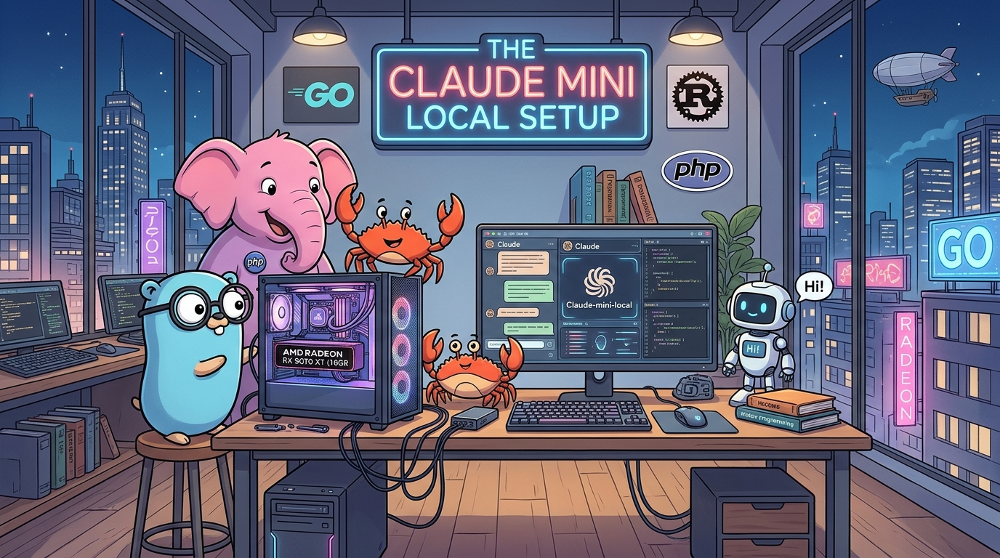

# claude-amd



## Setup

You need Ollama first to run this project.

You should (or not) have `Opencode`, `Pi` and `Omp (oh-my-pi)` installed on your system to get some fun.

```sh
git clone https://github.com/claude-amd/claude-amd.git
cd claude-amd
ollama create claude-mini -f ./Modelfile
cp -r ./.dotfiles/. ~/
```

Then copy via shell or manually contents for:

- OpenCode
- Pi
- Oh-My-Pi

## Run

```sh
ollama run claude-mini
```

Or via `agents`:

```shell
pi
omp
opencode
```

## License

[MIT](./LICENSE)
